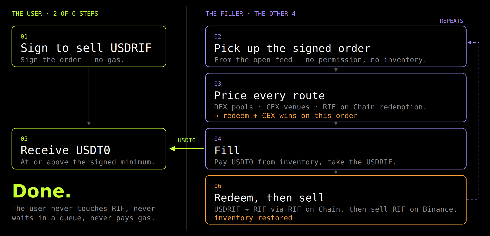

# [2608 Grant Proposal] 1delta Intents — permissionless solving on Rootstock

**Full proposal text, as amended after the forum discussion** (16 September 2026; this is the text forum reply #21 points to). Thread: [https://gov.rootstockcollective.xyz/t/2608-grant-proposal-1delta-intents-permissionless-solving-on-rootstock/929](https://gov.rootstockcollective.xyz/t/2608-grant-proposal-1delta-intents-permissionless-solving-on-rootstock/929). Changes from the 2 August post are listed under *What changed* below, with who raised each; all but one came from that thread. All on-chain figures were re-measured on 16 September 2026 at block 9,244,476.

> **Status since this text.** T1 went on-chain as its own proposal; M1–M4 each follow as a separate proposal when the milestone is reached. The pre-audit beta has been live on Rootstock mainnet since 9 October 2026; addresses and verification are in [deployment-rootstock-beta.md](../../deployment-rootstock-beta.md). The proposal text below is unchanged from 16 September.

## Executive summary

**The problem**

* USDRIF and RIF are easy to mint or buy, but hard to sell.

* The DEX exit is unreliable. Between July and August the main pool's stablecoin side moved from ~$137k to $37k to $124k while total pool value stayed flat — the same liquidity moving from one side to the other. LPs have since added, and it stood at $270k on 16 September. Whichever side is thin when a holder needs it decides the price.

* Large trades can get very different prices depending on the week. A **$100,000** USDRIF purchase returned **66,466 USDRIF on 5 August** and **100,167 on 16 September**.

* A third pool has had almost no stablecoin liquidity for months: 38 USDT in July, 14 USDT in August and about **$4,700 today against 81,948 USDRIF**.

* The only exit that is always available is RIF on Chain redemption. It pays **RIF, not a stablecoin**, goes through a queue and only works one way. Holders are using it: **138,744 USDRIF (5.8% of supply) was redeemed between 2 August and 16 September.**

**How it works**

* The user **signs an intent** saying what they give and what they must receive. No transaction, no gas and no custody given up.

* **Solvers compete** to fill it and keep whatever margin they find. Best price wins.

* The solver chooses the route at execution time: DEX, CEX, or RIF on Chain mint/redemption. The user doesn't need to know which route is best.

* The contract enforces the minimum. A solver offering less **cannot complete the transaction**.

**Why it stays open**

* **No whitelist, no application form.** Any address that beats the price can fill.

* **No inventory required.** A solver can source the tokens during the fill, so it needs gas, not trading capital.

* **No admin, pause or upgrade path.** Once deployed, nobody can close the solver set, including us.

**What it adds**

* **Market orders** run as a priority auction. The user signs a guaranteed floor; solvers outbid each other within the next block and the highest bid fills, with the winning bid paid to the user as a better price.

* **Limit orders**, including prices the current book has not reached.

* **Scheduled (TWAP) orders**, so a treasury can exit over hours or days instead of in one trade.

* Every order can be **partially filled**, so a large order doesn't need one counterparty.

**Impact for Rootstock**

* A working exit for USDRIF holders, with better execution at size.

* RIF moves through RIF on Chain in both directions — redemption and mint — and we report them separately.

* The settlement core, SDK, reference solver, order backend and dashboard are open source ([1delta-DAO/1delta-X](https://github.com/1delta-DAO/1delta-X), MIT). Anyone can run a solver or order book, including against us.

* Rootstock gets the primitive first, and it stays open because the contracts have no admin who can close it.

**The ask**

* **$35,000**, released against milestones. **8.6% on approval**; 91.4% behind delivered on-chain outcomes; **28.6% behind a post-completion impact review**.

* The audit is **43% of the budget** because these are new and immutable contracts.

## What changed after the forum discussion

| Change | Raised by |
| --- | --- |
| Tranches restructured: M4 is now **$10,000 (28.6%)** and releases only after an impact review against the Value Commitment Plan, 12 months post-funding. $1,000 came off M1 and M3, $2,000 off M2 | Tané |
| M2 now requires **≥$10,000 settled by solvers we do not operate**, rather than only requiring one such solver | Curia |
| SDK, reference solver and onboarding docs move into **M1**, so an external team can integrate before the M2 gate | Curia |
| Qualifying volume is reported **redemption-side and mint-side separately from M1**, with mint-side floors of **≥$50k at M3 and ≥$100k at M4** | ChronoTrigger |
| M2 audit wording changed to **all high and critical findings closed and re-reviewed** | ChronoTrigger |
| TVL commitment: of the $30,000, **≥$10,000 must come from solvers we do not operate**; our own inventory is reported separately | ChronoTrigger |
| RIF Economy claim corrected: redemption releases RIF, minting absorbs it. It moves RIF in both directions and does not create net RIF demand | ChronoTrigger |
| Auditor about to be chosen from the providers on [Areta](https://areta.market/#providers); scope posted before the vote, firm named at M1 with the engagement | ChronoTrigger |
| Redemption fee corrected from 0.25% to the current on-chain **0.20%** | LEGOSI |
| Incident-response procedure added for the immutable contracts; allowances default to time-bounded; pre-audit approvals capped in the interface | LEGOSI, Kath |
| Success metrics added: price improvement vs best route, time to settlement, independent solver count | LEGOSI, iamChekwube |
| Settlement core published before the vote: [github.com/1delta-DAO/1delta-X](https://github.com/1delta-DAO/1delta-X) | Tané |
| Order backend is open source; anyone can run their own book; decentralised transport is the objective after M2 | Seviramar |
| Executive summary added | iamChekwube |
| M1 testers recruited through raffles within the caps; solvers are not named publicly, but verified on-chain | Curia |
| Market orders changed from a Dutch auction to a **priority auction**, which fits Rootstock's ~30-second blocks; the contracts support both and no code changed | 1delta, during implementation |

## Project Name & Description

**1delta Intents** — Bitcoin-native intent settlement deployed on Rootstock. Users sign what they want, and an **open set of solvers competes to deliver it**. Anyone can solve from the start, with no whitelist and no inventory of their own. The first market we open this way is USDRIF, where the need is clearest.

**This will be the first intent settlement system that is permissionless all the way down.** The smart contracts are immutable and ungoverned. Anyone can solve from the start, and nobody can later take that away.

For comparison: CoW Protocol uses a bonded, allowlisted solver set, and 1inch Fusion uses whitelisted resolvers. Both work well, but a new solver has to be admitted before it can compete. Some other systems leave filling open. We have not found one where the contracts themselves guarantee that openness. In every system we know, the operator can close the solver set by changing a setting. Ours has no admin who can do that. Rootstock gets that first.

### The problem

USDRIF and RIF are easy to mint or buy — and hard to sell. The DEX exit is thin, one-sided and unstable.

We measured the main USDRIF/USDT0 pool five times between July and September. Between July and 5 August its stablecoin side — the side an exiting holder needs — went from ~$137k to $37k to $124k while total pool value barely moved: the liquidity moved from one side to the other. LPs have added since, and the stable side stood at $270k on 16 September. The depth is there some weeks and not others.

That means a large order can get a very different price depending on when it happens. On 5 August, a $100,000 USDRIF purchase on that pool returned **66,466 USDRIF**. On 16 September, the same pool returned **100,167**. A holder cannot know in advance which of those prices they will get.

Holders are leaving anyway through redemption, the one route that is always available. Between 2 August and 16 September, supply fell from 2,383,035 to **2,244,291 USDRIF — 138,744 redeemed, 5.8% of supply** — through the RIF on Chain queue, which pays RIF rather than a stablecoin.

The per-pool numbers at block 9,244,476 (16 September 2026), with each pool's stable side over time:

| Pool | Fee | USDRIF side | Stable side | Stable side, earlier |
| --- | --- | --- | --- | --- |
| USDRIF / USDT0 | 0.05% | 161,000 | $270k | ~$137k Jul · **$37k** 2 Aug · $124k 5 Aug · $241k 14 Sep |
| USDRIF / USDC.e | 0.30% | 31,880 | $75k | ~$53k Jul · $62k Aug |
| USDRIF / USDT | 0.05% | 81,948 | **~$4,700** | 38 USDT Jul · 14 USDT Aug · ~$1,000 11 Sep · ~$5,400 14 Sep |

Every balance is checkable on-chain: USDRIF/USDT0 `0xd845702AF381f0405661747A6A20BDE0401a19d6` · USDRIF/USDC.e `0xbb29453a0a0d1566bb84924136c909e2d3f6b5f4` · USDRIF/USDT `0x69c4D1FcD58CBDd7f9857aC4F8d56A1Cc6B598Fe`.

A pool absorbing one-way flow cannot rebuild the depleted side by itself. An LP that sells stablecoins for USDRIF ends up holding USDRIF. **A pool position cannot redeem that USDRIF through RIF on Chain**, so it stays in the pool until someone buys it.

The only deep exit pays RIF instead of a stablecoin, settles through a queue and works in one direction. There are also no limit orders, no scheduled execution and no way for two holders to trade directly with each other.

### What the protocol does

An intent is a signed statement of an outcome: what the user gives, what they must receive, any conditions attached and whether the order can be filled in parts. The user signs it in their wallet. There is no transaction, no gas and no custody given up.

Anyone can execute it on-chain and keep whatever margin they find, as long as they deliver at least what the user asked for.

The party doing that execution is a **solver**. We use *filler* and *solver* interchangeably below, and in our code and architecture diagram. They mean the same actor.

Three things follow from that:

* **The settlement contract is the validator.** It records how much of each order has been filled and rejects anything beyond that, so an order cannot be replayed, double-spent or over-filled.

* **Protection is in the code.** Every order has a minimum the user must receive. A filler offering less cannot complete the transaction; it reverts. Users do not have to trust a particular filler, or us.

* **Orders can be filled in parts.** A large order does not need one counterparty big enough to take it all. Several fillers can take different slices, at different prices and times, while the settlement contract tracks what remains. The minimum applies to every slice.

* **The filler pays the gas.** A USDRIF holder who has never held rBTC can still trade. Token access is granted once through a shared permission layer rather than approving every trade.

### What this adds to Rootstock

| Order type | What it does |
| --- | --- |
| **Market** | Runs as a **priority auction**: the user signs a guaranteed floor, fillers outbid each other within the next block, and the highest bid fills. It fills against whichever route wins — pool, resting order or redemption |
| **Limit** | Rests until the named price is met, including prices the book has not reached. It can sit inside the spread and become the new best bid or ask |
| **Scheduled (TWAP)** | Executes one slice per interval, so a treasury can exit or accumulate over hours or days instead of moving the market in one trade |

**How a market order finds its price.** The user signs two prices: a floor they are guaranteed, and a better price above it. The order is fillable at the floor from the first block. Fillers compete by attaching a higher gas price to their fill: every unit of gas price above the block minimum moves the user's price from the floor toward the better price, on a scale fixed in the order. Rootstock nodes order transactions by gas price, so the highest bidder is included first and wins; the others find the order taken and revert. The user gets the floor plus whatever the competition adds, and settles in the next block.

**Why a priority auction on Rootstock.** Rootstock blocks arrive about every 30 seconds on average, with wide variance (the two redemptions under *What we measured* took 65s for 3 blocks and 144s for 2 blocks). A Dutch auction, where the price decays over time until a filler takes it, can only step once per block on-chain. Either each step gives away a large slice of price, or the auction takes many minutes to reach the market, and a slowly decaying price stays visible to every filler for the whole interval, so none has a reason to take it early. A priority auction turns the long interval into a bidding round: fillers see and outbid each other in the mempool for the whole 30 seconds, every bid lands in the same block, and the order settles in one block rather than many. Rootstock caps a transaction's gas price at 100 times the block minimum, so the bidding range is bounded and known when the order is signed. The contracts also support a time-decaying Dutch price, in seconds or in blocks, which we keep for chains where transaction ordering does not reward the user.

Two details matter in practice. The order sets a small **baseline gas price** that does not count as a bid, so the ordinary cost of being included in a busy block is not mistaken for price improvement.

An order can also name an **exclusive filler** for an opening window, either blocking others or requiring them to beat that filler by a set margin. The user chooses this on their own order. The protocol itself does not restrict who can fill.

Every order can be **partially filled**, which is what makes large orders workable in a thin market. A holder selling 200,000 USDRIF does not need one filler willing to take all 200,000. One filler can take what the pool supports, another what redemption supports, a third the rest an hour later, while the remainder stays in the book.

With all-or-nothing execution, that holder would have to sell the whole amount into a thin pool at once and accept the slippage.

### The core primitive: redemption-backed fills

A filler pays a USDRIF seller from its own stablecoin inventory and, in the same transaction, escrows that USDRIF into a RIF on Chain redemption.

One signature from the user, no gas and no need for the user to wait for the redemption queue. The filler does not accumulate USDRIF; it converts it back to stablecoin each time:

1. Pay the seller from stablecoin inventory, at or above the contract-enforced floor.

2. Escrow the received USDRIF into redemption in the same transaction, with a minimum-proceeds floor.

3. Receive RIF after 2–3 blocks. We measured a median of 65s across 49 real mainnet redemptions.

4. Sell the RIF back into stablecoin inventory on the filler's own schedule.

The filler therefore holds RIF for 2–3 blocks per fill instead of holding USDRIF indefinitely, and its capital can be reused.

A passive pool cannot redeem, so one-way selling drains it. A filler can redeem, so the same one-way selling becomes a business.

Step 4 relies on off-chain RIF liquidity. The largest on-chain RIF pool held $48k of USDT0 on 16 September, against a ~$82M market cap that trades ~$7M a day, almost all on centralised venues.

That limits how quickly a filler can convert RIF back to stablecoin, which is why the mint route matters. In August, converting RIF back to stablecoin by minting USDRIF and selling it beat both the RIF pool and the combined CEX book at $100k (full route tables are in the discussion thread).

This does not limit what an individual user can sell. The user is paid from standing inventory in step 1 and is finished at that point.

### Why solving is open to anyone

* **No whitelist, no application form.** Any address that beats the price can fill the order. CoW Protocol and 1inch Fusion proved the model works, and both curate who can solve. Ours is open from the start.

* **No capital barrier either.** With in-transaction sourcing, a filler with no inventory can pull tokens from a DEX or aggregator inside the fill and still deliver the user's minimum. A solver needs gas money, not trading capital.

  This also sets the pricing floor: a solver routing through existing aggregators is **immediately at least as competitive as the best execution Rootstock offers today**, and can improve on it whenever redemption, minting or a resting order beats the pools.

* **The economics work.** Solver capital is reused instead of stuck in a pool. Redemption serves USDRIF sellers, minting serves USDRIF buyers, and inventory returns to stablecoins either way.

  The margin is the spread between RIF on Chain's mint and redemption rates and prices on DEXs and CEXs. A solver earns whenever those prices differ. A passive LP cannot do that.

This means there is no application, capital requirement or waiting period. A solver can start whenever it wants, and every additional solver can improve prices for users.

## Team Background

Core team building non-custodial DeFi infrastructure since 2023. Entity: **1delta Labs Ltd**, a UK company.

| Name | Role | Contact | Links |
| --- | --- | --- | --- |
| **Achim Huebl** | Co-founder & CTO — protocol architecture, settlement contracts, redemption module | [achim@1delta.io](mailto:achim@1delta.io) · Telegram `@Achthar` | [LinkedIn](https://www.linkedin.com/in/achim-huebl-a01403136) · [GitHub](https://github.com/achthar) |
| **Kevin Schellinger** | Co-founder & CEO — go-to-market, filler and partner onboarding | [kevin@1delta.io](mailto:kevin@1delta.io) · Telegram `@schellinger` | [LinkedIn](https://www.linkedin.com/in/schellingerkevin/) |

**We've built this pattern before.** 1delta Unite is a 1inch Limit Order Protocol extension that opens margin positions against Aave and Morpho Blue. It is gasless for the user and uses fillers that hold no inventory.

It took first place in 1inch's "Expand Limit Order Protocol" track at ETHGlobal Unite DeFi ([showcase](https://ethglobal.com/showcase/1delta-unite-kyoz4)). We have already built and shipped signed orders, competing fillers, gasless execution and non-custodial settlement.

**In production.** Our lending aggregation runs across **40+ chains and 300+ lending markets, with 150+ protocol deployments and $200M+ in transactions processed**.

Integrations include Aave v2/v3, Compound V2/V3, Morpho Blue and Euler v2, written in Solidity and Yul. The Compound integration was audited by **Certora**. We also took first place at the StableHacks Grand Finale (Solana Foundation / Tenity / AMINA Bank).

We've had grants from Aave, Compound, Polygon and Mantle. Those funded a different product on a different codebase — margin trading on lending — and are listed as prior funding rather than overlapping scope.

## Total Grant Amount

**$35,000 total**, milestone-gated. **Requesting $3,000 for the first tranche (T1, released on approval).**

The first release is called T1 rather than M1 because it only exists to book the audit slot. The $12,000 M1 tranche follows once the milestone below is delivered.

The Strategic tier permits a 20% initial tranche, which would be $7,000 here. We're asking for $3,000, only to book the audit slot that makes the timeline work. That is 20% of the $15,000 audit line, which is a standard deposit to hold a reviewer's slot.

The core is already built, so we do not need DAO capital to reach M1. That leaves **91.4% of the grant behind on-chain outcomes** that any delegate can check without trusting us, and **28.6% behind a post-completion impact review** on top.

| Tranche | Released on | Amount | Cumulative |
| --- | --- | --- | --- |
| **T1** | Approval | $3,000 · 8.6% | $3,000 |
| **M1** | Redemption path live | $12,000 · 34.3% | $15,000 |
| **M2** | Audited & open, with independent solver volume | $5,000 · 14.3% | $20,000 |
| **M3** | Volume | $5,000 · 14.3% | $25,000 |
| **M4** | KPIs met **and** impact review passed (12 months post-funding) | $10,000 · 28.6% | $35,000 |

**Budget:** independent audit and remediation $15,000 (43%) · protocol engineering — order backend, frontend, limit and scheduled orders — $10,000 · filler and inventory tooling $5,500 · SDK, docs and public analytics dashboard $4,500.

We are not asking for filler inventory. Fillers bring their own capital.

## Milestone 1 Deliverables

**Tranche: $12,000.** All six deliverables are required to unlock it.

| # | Deliverable | KPI |
| --- | --- | --- |
| a | Contracts deployed and verified | Live on Rootstock mainnet, verified on the explorer |
| b | Order backend live | Signed orders accepted, indexed and served to fillers |
| c | Public frontend live | Market swaps and limit orders work end-to-end from a connected wallet |
| d | **Real redemption-backed volume** | **≥$10,000 USDRIF filled**, ≥25 fills, ≥10 addresses unrelated to 1delta, each combining payout and redemption in one transaction, under per-fill and cumulative caps published before the first fill; full transaction-hash list published |
| e | Audit engaged | Reviewer named, scope published, deposit paid |
| f | SDK and reference solver published | Open source with onboarding docs, so an external operator can integrate before the M2 gate |

**(a) and (b) are the protocol going live:** contracts on mainnet, verified, with a backend that accepts signed orders, indexes them and serves them to fillers.

**(c) is the public interface:** a holder connects a wallet, places a market swap or limit order and signs once.

**(d) is the volume-based PoC:** we prove the system works with real users at smaller volume.

**(e) is the audit engagement:** we book the audit, which is delivered through M2.

**(f) is the tooling:** the SDK, reference solver and onboarding docs ship here rather than at M2, so an external team has everything it needs before the independent-volume gate.

**Why $10,000 and not more.** Ecosystem-wide USDRIF DEX volume was around $54k/day when measured in July 2026, so $10,000 is about four and a half hours of flow that already happens.

We set the bar low on purpose. This is pre-audit, and a milestone that needed a marketing push to clear would mean pushing unaudited contracts at people. The ≥25 fills across ≥10 addresses matter more than the dollar amount because they show repeat use rather than one friendly transaction.

**What M1 proves.** That the full cycle works on mainnet. Each fill pays a user from filler inventory and turns the received USDRIF back into working capital through redemption in the same transaction.

$10,000 of throughput on a few thousand dollars of standing inventory shows that filler capital gets reused, while pool capital gets stuck. That is the mechanism the dead USDRIF/USDT pool lacked, now tested with real users.

**M1 is also where we find gaps.** A small group of real users on mainnet tells us things a fork test cannot: what is confusing in the order flow, what a treasury actually wants from a scheduled order, whether the filler tooling is good enough for someone else to run, and which features we thought were done but are not.

It is better to learn that from ten early users before the audit than from thousands of holders after it. Weeks 6–11 cover audit remediation and whatever M1 feedback shows the product still needs. That means the public launch at M2 is based on real feedback, not just our own testing.

**About the risk before the audit.** M1 needs at least 10 addresses that are not ours, so real people will sign against unaudited contracts. That is a real risk. We keep it small:

* Approvals are capped in the interface at around 1,000 USDRIF per user, plus a cap on total filled before the audit. Both figures are published before the first fill. The main historical failure mode for settlement contracts is standing approvals ([Paraswap](https://medium.com/neptune-mutual/analysis-of-the-paraswap-exploit-1f97c604b4fe), [MatchaMeta/SwapNet](https://finance.yahoo.com/news/matcha-meta-breach-drains-16-113348450.html)); our security model is designed around that risk, and the cap limits the worst case.

* Allowances default to time-bounded rather than unlimited, so exposure decreases for inactive users.

* The frontend clearly warns that the contracts are unaudited throughout M1.

* There is no marketing to the wider holder base until findings are fixed at M2. M1 testers are recruited through raffles for small trades within the caps.

* The caps are enforced in the interface during M1, not by contract logic. These limits exist to protect users from unaudited code, so they should not depend on that code working correctly.

We fill M1 ourselves, either from our own inventory or by sourcing on-chain during the fill, so nobody else's filler capital is at risk.

## Milestones 2, 3 & 4

The Strategic tier requires four checkpoints.

| Milestone | Deliverables | KPIs | Tranche |
| --- | --- | --- | --- |
| **M2 — Audited & open** | Audit report published; **all high and critical findings closed and re-reviewed**; public launch | **≥$10,000 settled by solvers we do not operate** · ≥30 unique wallets | $5,000 |
| **M3 — Volume** | Public analytics dashboard reporting volume by side, users, fills, committed filler inventory and pool depth | **≥$400k cumulative qualifying volume**, including **≥$50k independently filled** and **≥$50k mint-side** · ≥120 unique wallets | $5,000 |
| **M4 — Scale & close** | Scheduled (TWAP) orders live in production; funding-efficiency report; retrospective AMA; **impact review** against the Value Commitment Plan at 12 months post-funding | **≥$750k cumulative qualifying volume**, including **≥$150k independently filled** and **≥$100k mint-side** · **≥$50k through scheduled orders** · ≥250 unique wallets · **review passed** | $10,000 |

**M2** does three things. The audit report is published with every high and critical finding closed and re-reviewed. The public launch happens. And solvers we do not operate must have settled at least $10,000.

That volume is verified from the filler address on each settlement. It proves that other people are using the infrastructure, not just us.

The SDK and reference solver are already available from M1, so an external team has the full M2 window to integrate. The wallet floor of 30 is deliberately low: before the findings are fixed, we onboard users directly rather than marketing to the wider holder base, so those wallets are hand-recruited. The jump to 120 and 250 comes after public launch.

**M3** makes the numbers public. The analytics dashboard reports volume, unique users, fill counts, committed filler inventory, USDRIF pool depth, and the split between independent fillers and our own.

From then on, the DAO does not need to rely on our reports to check the numbers. The volume bar moves to $400k cumulative, with a $50k independent floor and a $50k mint-side floor.

The dashboard reports redemption-side and mint-side volume separately because redemption releases RIF from collateral and minting absorbs it. We do not expect those two sides to be equal.

**M4** is scale plus scheduled orders: $750k cumulative, with a $150k independent floor, a $100k mint-side floor and at least $50k through TWAP orders.

Scheduled execution is the use case that most needs order-driven liquidity: selling a large position without pushing the price down in a thin pool.

Every gate is checkable on-chain. The M4 tranche is released only after an **impact review at 12 months post-funding** against the Value Commitment Plan, in addition to the KPIs above. It also closes with the funding-efficiency report and a retrospective AMA.

**Counting rules.** There are two independence tests, and they do different jobs.

*User independence* applies from M1 with no exceptions: no fill counts toward any KPI if the user side is an address we control.

*Filler independence* applies from M2. We run the first filler by design, so our volume counts, but there is a separate minimum for volume settled by fillers we do not operate. We use a minimum for independent volume rather than a maximum for our own volume because a maximum would reward us for filling fewer orders.

*Route split:* every fill records which module settled it. Redemption-side and mint-side volume are reported separately from M1, and the M3/M4 mint-side floors count only fills settled through the mint module.

Solvers are not named publicly. Independent volume is verified from the filler address on-chain.

**Where the targets come from.** M1's $10k is about four and a half hours of ecosystem USDRIF volume measured in July 2026. M4's $750k is roughly 11% of the flow the ecosystem already does over the same 18 weeks.

The wallet ramp follows the marketing rules: 10 at M1 and 30 at M2 are hand-recruited during the pre-audit window; 120 at M3 and 250 at M4 come after public launch. 250 is about 3% of the 8,241 current USDRIF holders over roughly seven weeks of availability.

The independent-volume floors are based on when third-party fillers can realistically exist. The SDK and reference solver ship in M1, so a third party can integrate from week 5. $50k by week 15 and $150k by week 18 assume $5–12k a week settled by fillers we do not run.

Every gated metric is volume or unique users because those are things we can drive. Pool depth depends on third parties deciding to supply liquidity, so we report it monthly but do not gate payment on it.

**Value Commitment Plan.** Our TVL target is **$30,000 of filler inventory** standing against USDRIF markets within 12 months post-funding — capital committed to filling and measurable on-chain at any block — **with at least $10,000 from solvers we do not operate**. Our own inventory is reported separately.

The M4 impact review is measured against this target and the M4 KPIs. If we miss it, we keep operating our own filler and maintaining the SDK and dashboard past grant close, and report the shortfall and the fix in the next Monthly Activity Report.

*Note on FES: the 2.0× Strategic bar is met by the composite of TVL, users, volume and DAO engagement, all reported monthly.*

## How we reach these numbers

The KPIs depend on other people's behaviour, so here is how we plan to get there.

**Fillers.**

1. We run the first filler ourselves from M1, so the market works on day one and users do not face an empty book. This is intentional and is why M1 volume may be filled by us.

2. The reference filler, SDK and onboarding docs are published in M1, so an operator can run one without talking to us and has the whole M2 window to do it before the independent-volume gate.

3. We recruit directly: DEX and DEX-aggregator teams already routing on Rootstock, market makers active here, and existing solver teams looking for markets with less competition.

4. The entry barrier is low. With in-transaction sourcing, a filler needs gas money, not trading capital, so a new entrant does not have to raise inventory before competing.

5. M2 is gated on $10,000 settled by fillers we do not operate, so this is measured rather than assumed. We do not name solvers publicly; the filler address on each settlement is the evidence.

**Users.**

1. We line up the first users during the forum and AMA period, before T1 lands, so M1 does not start from zero. The target users are treasuries, DAOs, market makers and wallets that already hold USDRIF and need a way out.

   For M1 we run raffles to recruit testers for small trades within the approval caps. The frontend carries the unaudited-contract warning from day one. The early-user list is posted in the discussion thread before submission.

2. The public frontend is live from M1, with the unaudited-contract notice throughout the pre-audit period.

3. General launch comes only after remediation at M2, to the existing USDRIF and RIF holder base. Later, Rootstock ecosystem projects can use tailored modules when they need a specific action.

4. The SDK lets wallets and aggregators route into the order book. An aggregator that improves price discovery over existing depth is complementary to us rather than competing with us.

   We are also open to surfacing the flow in ecosystem interfaces — wallets or Collective surfaces — if there is interest. The SDK is built for that.

5. At M4, we target treasury-sized TWAP users who need to sell large positions without pushing the pool price down.

**If the numbers lag.** We keep operating and capitalising our own filler after grant close, keep the SDK, reference filler and dashboard maintained and open, and onboard fillers and treasury users directly until the value lands.

The shortfall and what we are doing about it go into the next Monthly Activity Report as soon as we see it.

## How it is measured

On-chain data is the source of truth. Every fill is a transaction and every order is a signature verified against the settlement contract, so these figures do not depend on our own reporting.

| What | How it's measured | Where it's published |
| --- | --- | --- |
| Volume, fill count, unique wallets | On-chain, from settlement events | Monthly report; public dashboard from M3 |
| M1's ≥$10,000 | Full transaction-hash list; each fill and matching redemption checkable independently | Published at M1 |
| Independent vs own-filler split | Filler address on each settlement | Monthly report, listed separately |
| Redemption-side vs mint-side volume | Module used on each settlement | Monthly report from M1; dashboard |
| Price improvement | Realised price per fill against the best single-venue route quoted at the same block | Dashboard from M3 |
| Time to execution | Signature timestamp to settlement, per order type | Monthly report; dashboard |
| Independent solver count | Distinct filler addresses over time | Monthly report; dashboard |
| TVL delta (committed filler inventory) | Token balances of filler contracts, readable at any block — own and independent listed separately | Monthly report; dashboard |
| USDRIF pool depth | Pool reserves | Monthly report; dashboard — reported, not gated |

**Monthly Activity Reports** go on Discourse between every milestone using the standard template.

On-chain: transaction count, TVL delta (own and independent), new wallets and unique users, and volume processed by side.

Off-chain: product progress, user and filler pipeline, social reach, blockers and the corrective action taken.

**Milestone AMAs** happen at each checkpoint, followed by a final retrospective.

## Timeline

About 4 months from T1 landing to the M4 KPIs. The M4 tranche itself releases after the impact review at 12 months post-funding.

The governance steps come first and are not counted in that timeline: KYB and Persona verification, 1–3 weeks of forum discussion, the initial AMA, on-chain submission (1,000 stRIF plus gas, which we will hold before posting), the 7-day vote and the timelock.

| Weeks | Engineering | Go-to-market | Gate |
| --- | --- | --- | --- |
| **1–5** | Order backend to production (order intake, indexing, filler feed); public frontend; mainnet deploy and explorer verification; redemption filler live and funded; SDK, reference solver and onboarding docs published | First users onboarded; frontend carries the unaudited-contract notice; first fills executed and hashes published | **M1** |
| **6–11** | Audit execution; all high and critical findings closed and re-reviewed | Public launch after remediation; filler recruitment through direct outreach to DEX and aggregator teams, Rootstock market makers and existing solver teams | **M2** |
| **12–15** | Public analytics dashboard; scheduled (TWAP) order rollout | Treasury and DAO outreach for scheduled exits; aggregator and wallet integration conversations through the SDK | **M3** |
| **16–18** | Hardening, dashboard completion, funding-efficiency reporting | KPI close-out, retrospective AMA | **M4 KPIs** |
| **Month 12** | — | Impact review against the Value Commitment Plan and M4 KPIs | **M4 tranche** |

**What's already built.** The settlement core, shared permission layer, order and scheduling model, USDRIF redemption module and redemption filler are implemented and tested against a Rootstock mainnet fork using the live RIF on Chain, USDRIF, RIF and USDT0 contracts.

The code is public at [github.com/1delta-DAO/1delta-X](https://github.com/1delta-DAO/1delta-X) under MIT, with three internal security reviews (18 June, 29 July and 6 August 2026) and no external audit yet — which is what this grant buys.

Weeks 1–5 are about making the existing code production-ready and deploying it, which is why M1 takes five weeks.

## Technical Specs

**Architecture.** Three pieces: a settlement contract that verifies signatures and tracks fill state, a shared permission layer that holds token allowances, and per-market modules. For USDRIF, that includes the RIF on Chain redemption module.

Fillers run their own contracts and are not part of the protocol.

The order has two halves.

**Validators are the conditions** — when the order can execute: a price level, health factor, deadline or any predicate that must hold on-chain.

**Execution modules are the actions** — what actually happens: a swap, redemption, stake or lending operation.

The settlement contract checks the validators, runs the modules and either completes everything or reverts. This lets one signature express actions beyond a swap, and adding a market means writing a module instead of changing the core.

**What this grant covers.** The settlement core, permission layer and **USDRIF solver contracts** — filling orders through RIF on Chain mint and redemption — plus the order types that sit on top.

**Admin roles: none.** `Settlement` takes one constructor argument and has no owner, admin role or pause. The permission layer has no admin either.

**Upgradeability: none.** No proxy, initializer or upgrade path. Once deployed, the contracts are final. The only privileged call over user funds belongs to the holder, who can revoke their own allowance at any time.

**If a vulnerability is found after deployment.** The contracts hold no funds at rest. Value moves atomically through a fill, so exposure is limited by outstanding allowances, and revocation is a complete fix per user.

The procedure is:

1. Stop new exposure — order intake stops and the interface goes down.
2. Publish a revocation notice with a one-click revoke path.
3. Disclose publicly within 24 hours on the forum and in our channels.
4. Deploy corrected contracts at a new address and migrate users. For an immutable system, redeployment replaces upgrades.
5. Publish a post-mortem, with the fix re-reviewed by the auditor before the interface points to the new deployment.

Nothing in the budget covers redeployment. The audit is the only review these contracts will get, which is why it is 43% of the ask.

**Order flow.** The backend that indexes signed orders and serves them to solvers is open source (`packages/orderbook`, `packages/orderbook-server`).

We run the first instance; anyone can run their own book. A decentralised transport (Waku-class gossip) is the objective once the contracts are audited. During M1 and M2 we keep the backend under our control so we can fix issues quickly.

**External dependencies.** RIF on Chain for redemption and minting, with its price provider, plus the USDRIF, RIF and USDT0 tokens.

For routing, solvers use whichever venue quotes best — Uniswap v3 via Oku's router, SushiSwap, Nordstern and the other DEXs and aggregators on Rootstock. None is a hard dependency; if one is unavailable, the solver uses another.

No bridges and no custom oracle. We use RIF on Chain's own price provider and enforce a minimum-proceeds floor rather than trusting a feed.

**What we measured.** Queue parameters read live from the RIF on Chain queue (`minOperWaitingBlk = 1`, `maxOperWaitingBlk = 3`).

Across **49 real mainnet redemptions**, every one settled inside the 2–3 block window, with a median of 65s and none expired or reverted. The dataset, with both transaction hashes per redemption, is [usdrif-redemptions.csv](usdrif-redemptions.csv): `MocQueue` `0x47f5014115d3bb29B20b5168Ee75050D6f8c3Bf1`, `OperationQueued` joined to `OperationExecuted` by `operId`, filtered to USDRIF redemptions, up to block 9,075,474.

The redemption and mint fees are a flat **0.20% charged in RIF** (read on-chain on 16 September 2026; the two July examples below used the earlier 0.25%). The execution fee is a flat **0.0000029364 rBTC** regardless of size, so a filler's cost per fill is predictable enough to quote a floor in advance.

Two examples, both checkable on Blockscout:

| | Median case | Slowest observed |
| --- | --- | --- |
| Operation | `2209` | `2076` |
| Request → settlement | block 9,047,098 → 9,047,101 | block 8,987,800 → 8,987,802 |
| Elapsed | 3 blocks · **65s** | 2 blocks · **144s** |
| USDRIF redeemed | 1,000.000000 | 2,000.000000 |
| RIF received, net of fee | 8,512.937942 | 29,055.551038 |

**What happens when something fails.** The fill is atomic: either the user is paid and USDRIF is escrowed into redemption in the same transaction, or the whole transaction reverts and nothing moves.

If the redemption later cannot meet its floor, the queued operation errors and RIF on Chain refunds the escrowed USDRIF to the filler. The filler can retry, and the user has already been paid.

We tested both paths against the live contracts on the fork.

**Audit status.** These contracts are new and have not been audited yet. That is what this grant buys, and it is 43% of the budget.

The share is high because the code is new. A grant that ports an already-audited product to Rootstock has no audit cost. This is not a port.

The settlement core, shared permission layer and USDRIF redemption module are new code implementing something that does not exist on Rootstock today. New code that moves user funds based on a signature needs review before anyone is asked to trust it.

Three things reduce the risk:

* We've shipped this pattern before, on 1inch.
* The mechanism is already tested against live RIF on Chain contracts on a mainnet fork.
* M1 proves it works on mainnet before the DAO funds the rest.

**Sequence.** The auditor, whichever firm is selected, is named at M1 with the engagement, per deliverable (e). The scope — settlement core, permission layer, USDRIF module and reference solver — will be posted in the discussion thread. Deposit paid at T1, audit engaged at M1, all high and critical findings closed and re-reviewed at M2, and public launch gated on that. The $15,000 line is sized above the $11k quote a cohort-1 builder reported in the guidelines thread.

**Status.** Nothing is on mainnet yet. Deployment is M1. *(As of 16 September; see the status note at the top.)*

## Value Prop for Rootstock

- **Permissionless solving, on Rootstock first.** The solver set is open from the start and stays open, because the contracts have no admin who could close it. Nothing on Rootstock works this way today. The Collective can point to this as a property of Rootstock infrastructure, independent of any one app.
- **USDRIF Adoption.** This addresses the measured constraint on USDRIF utility directly. Wallet swaps, treasury exits and payment rails all need a predictable exit, and holders get to leave into any stablecoin on demand instead of queueing for RIF.
- **TVL Movers.** The capital we attract is filler inventory committed to USDRIF markets, and we carry a $30,000 TVL target on it in the Value Commitment Plan. We report pool depth monthly but don't gate on it, because pool depth depends on third parties, while filled volume is something we can drive.
- **Rootstock Onboarding UX.** A USDRIF holder can trade without holding rBTC at all, because the filler pays gas. Time-to-first-transaction comes down to a wallet signature.
- **RIF Economy Enablers.** Every fill that touches RIF on Chain moves RIF: redemptions release it from collateral, mints absorb it. That moves RIF in both directions. We do not claim it creates net RIF demand; we report the two sides separately from M1 and require minimum mint-side volume at M3 and M4.
- **Public good.** The contracts, SDK, reference filler and analytics dashboard are open source, the order book is permissionless, and anyone can run a filler, including against us.
- **Built here first.** Rootstock is the first chain this is deployed on. That is why it needs a full audit, and it is why the Collective gets a primitive no other chain has yet.
- **Nobody else is bringing it.** CoW Protocol and 1inch Fusion proved this model on EVM chains. Neither is on Rootstock and neither has announced plans to deploy here, and both curate their solver set where ours is open from the start.

## Demo and GitHub repo

- **Interface mock:** <https://intents-demo.pages.dev/> — a clickable mock of how the app will work: an order book separating pool, limit-order and redemption-backed depth, limit and TWAP order entry, and the gasless signing flow. **It is a design mock, not a live app.** Nothing is connected to a network and the numbers in it are illustrative rather than measured. The measured figures in this proposal come from the on-chain sources described above, not from the mock.
- **Prior art, same pattern:** [1delta Unite — ETHGlobal showcase](https://ethglobal.com/showcase/1delta-unite-kyoz4)
- **Code:** <https://github.com/1delta-DAO/1delta-X> (MIT) — settlement core and permission layer (`packages/core`: Settlement, Permit3), protocol modules (`packages/modules`), reference solvers (`packages/solvers`), TypeScript SDK (`packages/sdk`), order backend (`packages/orderbook`, `packages/orderbook-server`), reference interface (`packages/app`). Organisation: <https://github.com/1delta-DAO>.

## Video Pitch

**<https://youtu.be/q-KigcOi1q8>** — *Fully Decentralized & Permissionless Intents on Rootstock Network*

---

All but one change in this version came out of the discussion thread. Thanks to LEGOSI, Tané, Curia, ChronoTrigger, iamChekwube, Kath and Seviramar.
